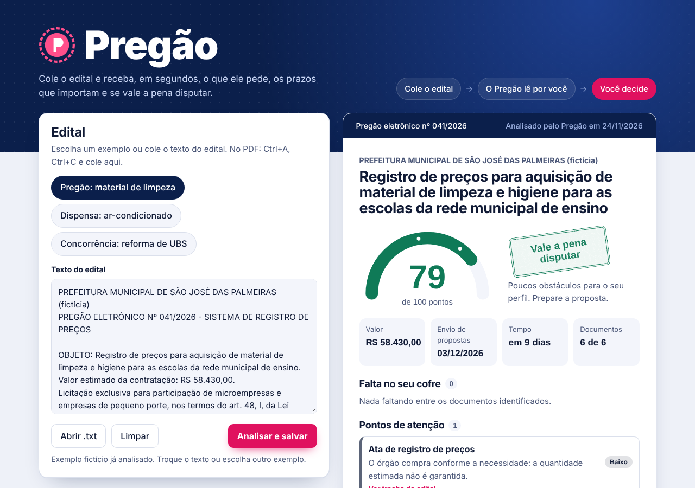
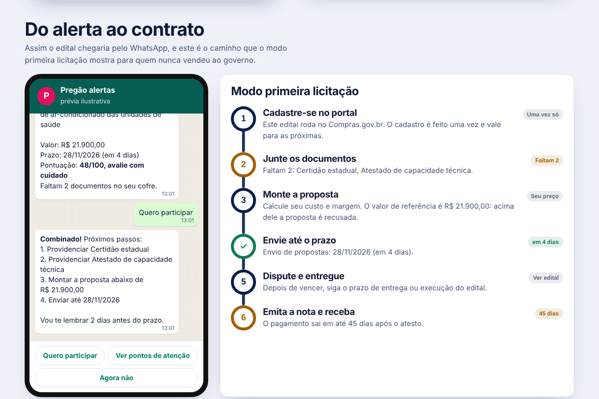

<p align="center">
  
</p>

<h1 align="center">Pregão</h1>
<p align="center"><b>Venda para o governo sem medo de edital.</b><br>
Cole um edital e veja em segundos o que ele pede, quais prazos importam e se vale a pena disputar.</p>

<p align="center">
  
</p>

## Sobre o projeto

O **Pregão** é um radar de oportunidades em compras públicas para **MEIs e pequenas empresas que nunca venderam ao governo**. A maioria deixa de vender por medo da burocracia, não por falta de produto. O Pregão lê o edital e responde: *você consegue ganhar isso? Vale a pena?*

Este repositório contém o **protótipo funcional** criado no Projeto Integrador (Mini-Produto) da disciplina **Ferramentas de IA e Chatbots**, Bacharelado em Inteligência Artificial.

**Equipe**
- Pedro Henrique Rocha Silva: Product Owner / CEO
- Erik França Nunes: Tech Lead / CTO

## Funcionalidades

| Funcionalidade | O que faz |
|---|---|
| Resumo em uma tela | Órgão, objeto, modalidade, número do edital, valor e próximo prazo |
| Pontuação de viabilidade | De 0 a 100, com medidor e carimbo de veredito: *Vale a pena disputar*, *Avalie com cuidado*, *Alto risco* ou *Prazo encerrado* |
| Cofre de documentos | Você marca as certidões que já tem. A página mostra o que falta e recalcula a pontuação na hora |
| Pontos de atenção | Visita técnica, amostra, garantia financeira, prazo curto, pagamento longo, multa alta e registro de preços, com gravidade |
| Trecho-fonte | Cada achado mostra a frase do edital de onde saiu, para conferência |
| Alerta no WhatsApp (simulado) | Prévia da mensagem, com as respostas *Quero participar*, *Ver pontos de atenção* e *Agora não* |
| Modo primeira licitação | Caminho em 6 etapas, do cadastro no portal até o pagamento, calculado a partir do edital |
| Histórico | Tabela com todas as análises, com opção de copiar para planilha |
| Testes com usuários | Registro de nota, compreensão e comentário dos 3 testes da atividade |

<p align="center">
  
</p>

## Como usar

**Online:** acesse o link do GitHub Pages, na seção *About* deste repositório.

**No computador:** baixe o repositório (*Code → Download ZIP*), descompacte e abra o `index.html` no navegador. Não precisa instalar nada.

1. Escolha um dos editais de exemplo (fictícios) ou cole o texto de um edital real. No PDF: Ctrl+A, Ctrl+C e cole.
2. Marque no cofre os documentos que sua empresa já tem.
3. Clique em **Analisar e salvar**.

## Estrutura do repositório

```
pregao/
├── index.html                  # Página principal
├── css/
│   └── style.css               # Estilos (tema claro e escuro, responsivo)
├── js/
│   ├── util.js                 # Funções de apoio, datas, moeda e limites legais
│   ├── dados.js                # Documentos, modalidades, portais e editais de exemplo
│   ├── analisador.js           # Motor de análise do edital (regras)
│   └── app.js                  # Interface: resultado, WhatsApp, rota, histórico e testes
├── assets/
│   ├── logo.svg
│   └── screenshots/            # Prints usados neste README
├── docs/
│   ├── relatorio-prompts.md    # Relatório de engenharia de prompts (entrega)
│   ├── testes-usuarios.md      # Roteiro e resultados dos 3 testes com usuários
│   ├── TAP_Pregao.docx         # Termo de Abertura do Projeto
│   └── Pregao_SWOT_Canvas.pptx # Matriz SWOT e Business Model Canvas
├── .gitignore
└── README.md
```

## Como funciona

A análise roda inteira no navegador, por **regras de leitura de texto** (palavras-chave e expressões regulares), em `js/analisador.js`:

1. O texto é normalizado (sem acentos e em minúsculas) para facilitar a busca, mantendo a posição de cada trecho no original.
2. As regras identificam modalidade, valores em R$, datas e o tipo de cada data, certidões exigidas e cláusulas de risco.
3. A pontuação parte de 70 pontos. Sobe com fatores a favor (exclusiva para ME/EPP +12, dispensa +6) e desce com concorrência (−8), documentos faltantes (−8 a −12 cada) e riscos (alto −12, médio −7, baixo −3).

**Base legal usada nas regras**
- Lei 14.133/2021, com valores de 2026 do Decreto 12.807/2025: dispensa para compras e serviços até R$ 65.492,11. Abaixo de 1/4 desse valor, a habilitação pode ser dispensada (art. 70, III).
- LC 123/2006, art. 48, I: em regra, itens de até R$ 80 mil são exclusivos para ME/EPP.

## Limitações do protótipo

- A leitura é feita por **regras**, não por um modelo de linguagem. Na versão completa, a leitura ficará com uma IA, mantendo o princípio de mostrar a fonte de cada achado.
- O alerta no WhatsApp é uma **simulação visual**. O envio real exige servidor e a API do WhatsApp Business.
- O **preço sugerido** ainda não está incluído, porque depende do histórico de preços vencedores do PNCP.
- Histórico e testes ficam salvos apenas no navegador de quem usa (localStorage).
- Não substitui a leitura completa do edital. A decisão de participar é sempre do fornecedor.

## Próximos passos

- [ ] Leitura do edital com modelo de linguagem, via API
- [ ] Coleta automática de editais no PNCP, filtrada por CNAE e região
- [ ] Preço sugerido com base em preços homologados
- [ ] Envio real de alertas pelo WhatsApp Business API
- [ ] Cofre de documentos com upload e alerta de vencimento

## Tecnologias

HTML5, CSS3 e JavaScript puro, sem frameworks. Fontes Red Hat Display e Red Hat Text (Google Fonts).
